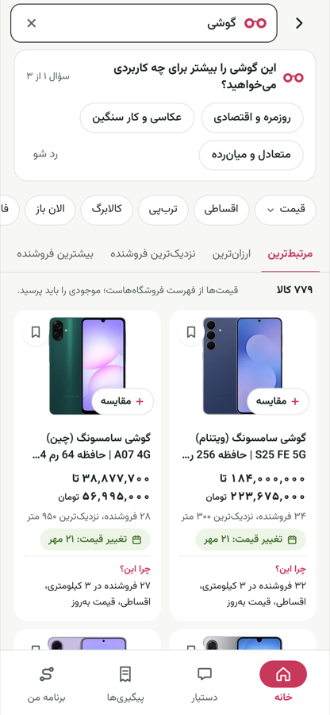
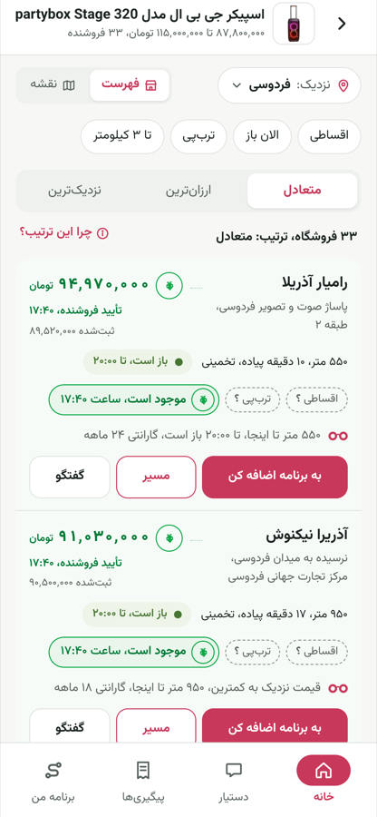
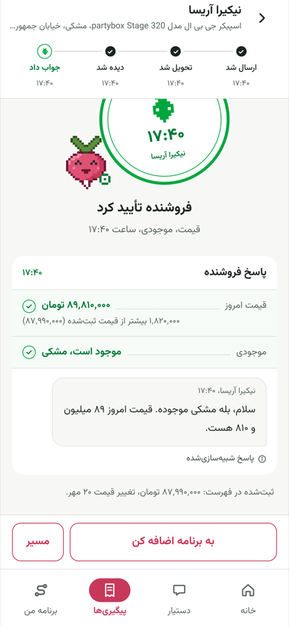
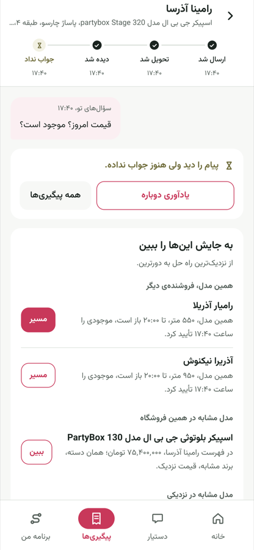
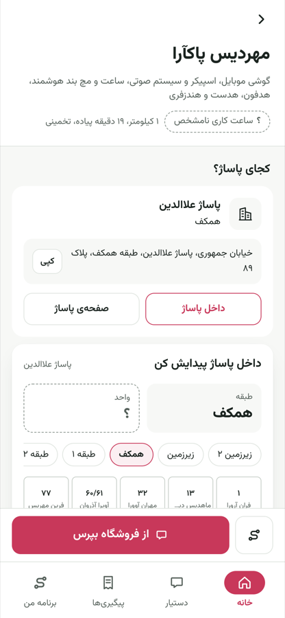
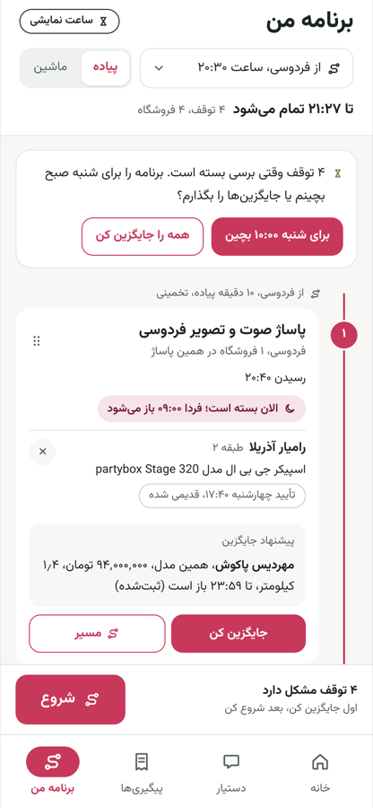

<p align="center">
  <picture>
    <source media="(prefers-color-scheme: dark)" srcset="bebin-kit/web/public/brand/lockup-bebin-glasses-night.svg" />
    
  </picture>
</p>

<p align="center">
  
</p>

<h3 align="center">An in-person shopping assistant for Tehran</h3>

<p align="center">
  <b><a href="https://bebin-web.liara.run">bebin-web.liara.run</a></b> &nbsp;·&nbsp;
  <a href="https://bebin-api.liara.run/api/docs">API docs</a> &nbsp;·&nbsp;
  <a href="TECHNICAL.md">Technical decisions</a>
</p>

<p align="center"><sub>Persian · RTL · mobile-first · installable PWA. Open it on a phone, or in desktop dev tools at 390×844.</sub></p>

---

Built for the Torob. It takes a shopper from "I want X" to a *verified visit*: what to buy, which store, when to go, where the store is inside the mall, and what the seller has actually confirmed.

<table>
  <tr>
    <td align="center" width="33%"><br/><sub><b>Choose</b>: understood filters and the need-finder</sub></td>
    <td align="center" width="33%"><br/><sub><b>Compare stores</b>: receipt rows with reasons</sub></td>
    <td align="center" width="33%"><br/><sub><b>Ask</b>: the seller's answer, stamped and timed</sub></td>
  </tr>
  <tr>
    <td align="center"><br/><sub><b>No answer</b>: alternatives, nearest first</sub></td>
    <td align="center"><br/><sub><b>Inside the mall</b>: floor, unit, neighbours</sub></td>
    <td align="center"><br/><sub><b>Go</b>: a plan that knows what will be open</sub></td>
  </tr>
</table>

##  What it does
| Challenge step / pain point | Where in the app |
|---|---|
| **1. Choose the product.** "I don't know which model is right" | Search understands budget, brand, installments and area from plain Persian («گوشی سامسونگ زیر ۶۰ میلیون اقساطی»). Need-finder questions cover use and budget. Compare products side by side. |
| **2. Find stores nearby** | Sellers list and map, ranked by your location, with walking or taxi ETAs. Related shops are kept separate, and the app never implies they carry the item. |
| **3. Compare stores** | Rank by price, distance or a balance of both. Each shop shows its opening status at your arrival time and a «چرا این ترتیب؟» breakdown. |
| **4. Contact stores** | «از فروشگاه بپرس»: ask up to 3 shops about today's price, stock, exact location or installments. Replies arrive live. |
| Stale prices | Every price shows its last-change date and freshness. A verified price from the seller replaces it, with a timestamp. |
| Closed store / no answer | Alternatives: same model at another shop, similar models at the same shop, then similar models nearby. The visit plan warns about stops that will be closed when you arrive. |
| Found the mall, not the store | Mall pages show floor and unit, the shop's neighbours, and directions. |
| Installments only | Installment, Torob Pay, Kala-barg and fast-delivery filters. Shops with no recorded data are shown as «نامشخص», never as "no". |

Also included:
- **Assistant:** a chat agent with tools. It searches, compares, finds sellers, asks stores after you confirm, and plans the visit.
- **Hybrid search:** keyword FTS5 plus vector embeddings, fused with RRF. It handles typos and synonyms.
- **Seller panel** (`/seller`) : answer inquiries as a shop, from a second phone.

##  Honesty, by design
- **Stock is never stated unless a seller answered,** and the answer shows *when* they said it. That is the stamp (مهر).
- **Listed price, last price change and seller verification** are always shown separately.
- **Unknown is a first-class value:** «نامشخص», drawn dashed, plus a way to find out.
- **Seller replies are simulated** because the dataset's phone numbers are fictitious. They are labelled «پاسخ شبیه‌سازی‌شده». `/seller` shows how a real reply would arrive.
- **Prices come from the dataset snapshot** (2026-10-13). Freshness is measured against that date, and the About page explains it.

##  Architecture
```
Phone (PWA, RTL) ──REST + SSE──▶ api: FastAPI, single instance
web: Next.js 16                    ├─ catalog.db  SQLite + FTS5, read-only, built from the CSVs
                                   ├─ app.db      SQLite (WAL): inquiries, verifications, LLM cache
                                   ├─ vectors/    226k × 256 (text-embedding-3-small), optional
                                   ├─ in-process scheduler: inquiry simulator + live SSE hub
                                   └─ llm.py ──▶ any OpenAI-compatible provider (daily token guard)
```
- **Deterministic code ranks and filters.** The LLM understands requests, asks questions, explains, and writes seller messages.
- **Every LLM feature has a non-LLM fallback.**
- **Stack:**
  - web: Next.js 16, React 19, TypeScript, Tailwind, TanStack Query, Zustand, Leaflet.
  - api: Python 3.12, FastAPI, pydantic v2, stdlib `sqlite3`, numpy.
  - The TS API types are generated from the OpenAPI schema.

Every decision, with its reasons and measurements, is in **[TECHNICAL.md](TECHNICAL.md)**.

```
bebin-kit/
  api/                  FastAPI app (app/), tests (tests/), Dockerfile
  web/                  Next.js app (app/, components/, lib/), Dockerfile, Playwright screenshot scripts
  data/                 build_catalog.py (CSVs → catalog.db), build_embeddings.py (catalog → vectors), raw/ (CSVs, not in git)
  scripts/              check_llm.py, smoke.sh, bench.py
  docker-compose.yml    both apps, locally, from the production Dockerfiles
  Makefile              setup · data · embeddings · upload-vectors · api · web · test · types · smoke · eval
```

##  Build it yourself
### 1. Get the data
**The Torob challenge dataset** is not in this repo. Put the three CSVs here:
```
bebin-kit/data/raw/shops.csv
bebin-kit/data/raw/products.csv
bebin-kit/data/raw/offers.csv
```

### 2. Build the catalog
You need [uv](https://docs.astral.sh/uv/) (it installs Python 3.12), Node.js 24 and `make`. Run everything from `bebin-kit/`:
```bash
cd bebin-kit
make setup              # uv sync (api) + npm install (web)
cp .env.example .env    # then edit; see "Configuration" below
make data               # CSVs → api/data/catalog.db (~70 s, ~520 MB) + test fixture + demo candidates
```

### 3. Run it: pick one option
**A. Docker Compose (one command).** This uses the same Dockerfiles as production:
```bash
docker compose up --build    # web → http://localhost:3000 · API → http://localhost:8000/api/docs
```
`API_PORT` and `WEB_PORT` change the ports. App data lives in the `api-data` volume, and `api/data/vectors/` is mounted if you built it.

**B. Development servers** (hot reload), in two terminals:
```bash
make api                # http://localhost:8000
make web                # http://localhost:3000
```

**C. Any Docker host or cloud.** Run the two images on your own server or cloud:
1. Build `api/` after `make data`; `catalog.db` is baked into the image.
2. Build `web/` with `--build-arg NEXT_PUBLIC_API_URL=https://<your-api>`. The URL is compiled into the bundle.
3. Run the API on port 8000 with a volume at `/data`, and set `CORS_ORIGINS` to the web origin.
4. Run the web app on port 3000.

### 4. Check it
```bash
make test                                         # pytest (API) + vitest (web); never calls the LLM provider
scripts/smoke.sh http://localhost:8000 http://localhost:3000
```

 **No LLM key?** Set `LLM_ENABLED=false`. Search, sellers, compare, ask the store (simulated), plan and the seller panel all still work. The assistant switches to keyword mode.

**With an LLM:**
1. Fill `LLM_BASE_URL` and `LLM_API_KEY`. Any OpenAI-compatible provider works.
2. Run `make check-llm` to see what the provider supports.
3. Use non-reasoning models for `LLM_MODEL_*`. `gpt-5.4-mini` is the default.

**Hybrid search (optional):**
1. Set `EMBEDDINGS_PROVIDER=api`.
2. Run `make embeddings`. This embeds ~226k products, costs about 10M embedding tokens for Persian titles, and is resumable.
3. Restart the API. `/api/meta` then reports `"search_mode": "hybrid"`.

##  How the live version is deployed
**The contest rules asked for deployment on [Liara](https://liara.ir), so the live version runs there.** Nothing in the code is Liara-specific: it's the same two Docker images as above. This is how we set it up, in case you want to reproduce it.

| Piece | On Liara |
|---|---|
| `bebin-api` | Docker app (1 GB plan), with the `data` disk mounted at `/data` for `app.db` and the vectors |
| `bebin-web` | Docker app, built with `NEXT_PUBLIC_API_URL=https://bebin-api.liara.run` |
| Vectors | A private object-storage bucket. Liara caps source uploads at 128 MB compressed and the catalog alone is ~113 MB, so the API downloads `vectors/` from the bucket on first boot (`make upload-vectors` puts them there). |
| Secrets | Liara environment settings (`liara env set`), never the repo |

```bash
npm i -g @liara/cli && liara login
cd bebin-kit/api && liara deploy      # app name from api/liara.json
cd ../web && liara deploy             # app name from web/liara.json
cd .. && scripts/smoke.sh https://bebin-api.liara.run https://bebin-web.liara.run
```
To deploy your own copy:
- **App names:** they are global on Liara, so set `"app"` in both `liara.json` files to names you own.
- **Pointing the two apps at each other:** pass `--build-arg NEXT_PUBLIC_API_URL=…` to the web deploy, and set the API's `CORS_ORIGINS` to the web origin.

##  Configuration
All settings are in `bebin-kit/.env.example`. The ones that matter most:

| Variable | Meaning |
|---|---|
| `LLM_ENABLED` | `false` runs every feature on its non-LLM fallback |
| `LLM_MAX_TOKENS_PER_DAY` | Hard daily budget. Past it, calls fall back instead of erroring. |
| `EMBEDDINGS_PROVIDER` | `api` turns on hybrid search when vectors exist; `off` means FTS only |
| `S3_*` | Only for a deployment that downloads vectors from a bucket |
| `SIMULATOR_SPEED` | Over 1 makes simulated seller replies arrive faster (good for demos) |
| `NO_ANSWER_TIMEOUT_S` | How long before an unanswered inquiry offers alternatives |
| `DEMO_DIRECTOR_ENABLED` | Demo controls on the About page: preset a shop's answer, override the clock |
| `CORS_ORIGINS` | Web origins allowed to call the API |
| `NEXT_PUBLIC_API_URL` | The API URL the web bundle calls. Build-time only. |

---

<p align="center">
  <br/>
  <sub>«قبل از رفتن، ببین.» Look before you go.</sub>
</p>
